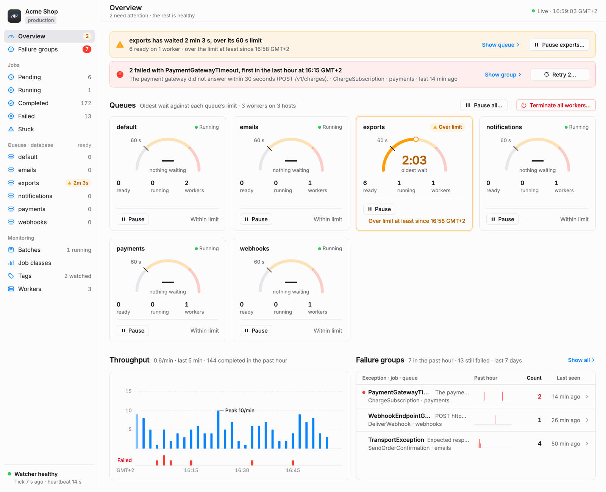
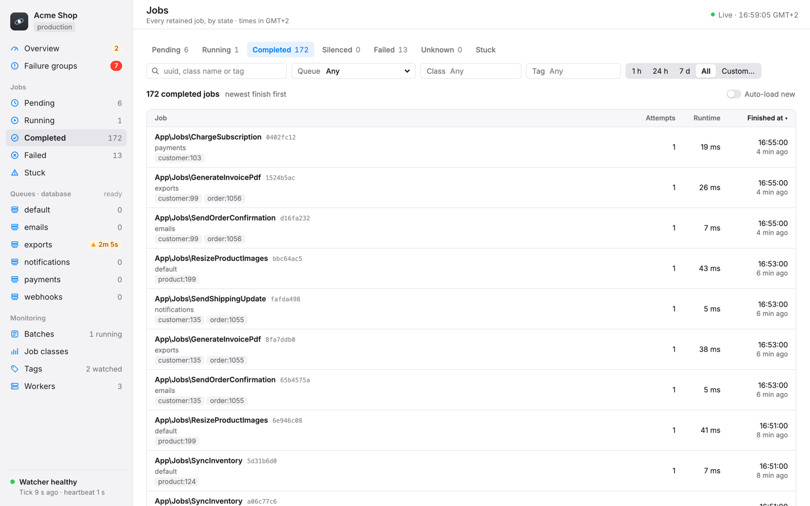
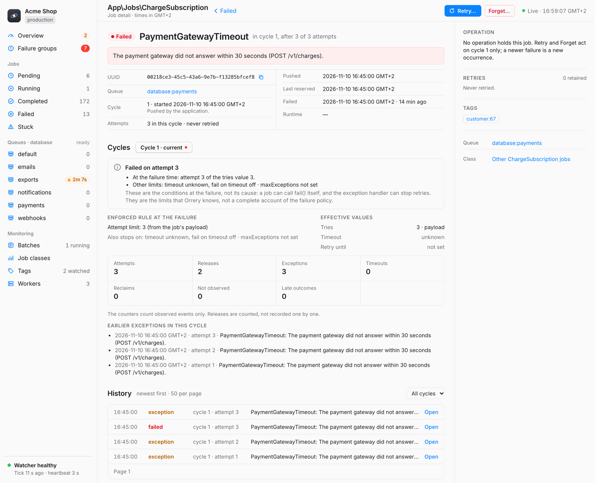
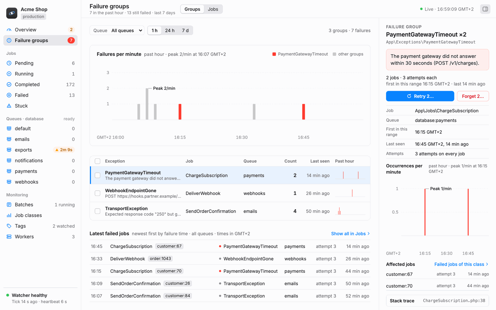
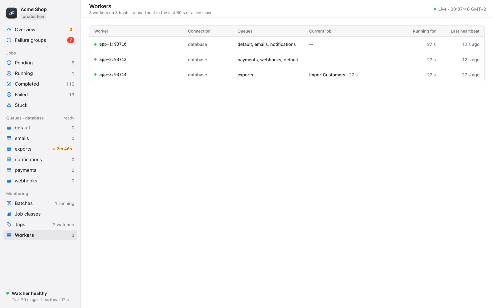

# Orrery

Orrery (`justrau/laravel-orrery`) is a Horizon-style dashboard for the `database` queue driver of Laravel. It shows your queues, jobs, failures, batches and workers, and it lets you retry failed jobs and pause workers. It is a watcher only: it never starts, supervises or scales queue workers. You keep running `queue:work` under systemd, supervisord, Forge or another process manager.

<picture>
  <source media="(prefers-color-scheme: dark)" srcset="docs/images/overview-dark.png">
  
</picture>

## What you get

- **Queues at a glance.** The wait and the backlog of each queue, against a limit that you set, with long-wait alerts by mail, Slack or SMS.
- **Every job in one list.** Pending, running, completed, failed, retrying and stuck jobs, with filters, a search and a job detail that shows the payload, the exception and the history, all redacted.
- **Failures in groups.** The failed jobs grouped by exception, message and job class. Retry or forget one job, or a whole group in a confirmed bulk run.
- **Stuck jobs.** Expired reservations, lost outcomes, repeated releases and unlimited attempts, each with the facts behind it and an event that you can listen to.
- **Worker controls.** Pause, continue and terminate workers globally, per connection or per queue, from the dashboard or the command line.
- **Metrics and markers.** Completed and failed jobs per minute, runtimes per job class, monitored tags, and deploy and restart markers on the charts.
- **Your tables stay authoritative.** `jobs`, `failed_jobs` and `job_batches` stay as they are. Orrery keeps its own mirror tables next to them, and its errors never reach your queue.

<p>
  
  
</p>
<p>
  
  
</p>

[The dashboard](docs/dashboard.md) shows every screen.

## Requirements

- PHP `^8.3`, and Laravel 12.69.0 or later, or 13.30.0 or later.
- MySQL, MariaDB, Postgres or SQLite. MySQL 8.4, MariaDB 12.3 (the latest LTS release), Postgres 18 and the SQLite of PHP 8.3 to 8.5 are tested. MariaDB 11.8 passed one full run for 0.4.
- The `database` queue driver, and the failed-job driver `database-uuids` (Laravel's default) for retry and forget.

[Installation](docs/installation.md#requirements) has the full list.

## Installation

Install it from [Packagist](https://packagist.org/packages/justrau/laravel-orrery):

```bash
composer require justrau/laravel-orrery:^0.4
php artisan orrery:install
php artisan migrate
```

Then set up the queue, SQLite (if you use it), access, the workers and the scheduler: [Installation](docs/installation.md) has each step.

Open `/orrery` in your browser. In the `local` environment everyone can use it. In other environments, define the gates `viewOrrery` and `operateOrrery` in `app/Providers/OrreryServiceProvider.php` (see [Access](docs/installation.md#access)).

## Documentation

- [Installation](docs/installation.md): requirements, the full install, the queue, SQLite, access, workers and the scheduler.
- [The dashboard](docs/dashboard.md): the screens and what the numbers mean.
- [Configuration](docs/configuration.md): every configuration key, and the retention.
- [Notifications](docs/notifications.md): long-wait alerts and stuck jobs.
- [Operations](docs/operations.md): pause, continue and terminate, retry and forget, bulk runs, deploys, worker pools, turning Orrery off and the commands.
- [Storage](docs/storage.md): database sessions, SQLite files, the optional and deferred indexes, and the measurement cache.
- [Security](docs/security.md): access, redaction and the Content Security Policy.
- [Known limits](docs/known-limits.md).
- [Performance](docs/performance.md).
- [Upgrading](docs/upgrading.md): upgrades and removing Orrery.

The [documentation index](docs/README.md) also links the architecture docs for contributors.

## Status and stability

- The package is on [Packagist](https://packagist.org/packages/justrau/laravel-orrery) as `justrau/laravel-orrery`.
- **Nothing is stable in 0.x.** The configuration keys, the commands and their options, the events (`LongWaitDetected`, `StuckJobDetected`, `JobFailed`), the `Orrery::` static API and the HTTP API under `/orrery/api` can change in any 0.x release. [CHANGELOG.md](CHANGELOG.md) names each change. A stability promise waits for 1.0.

## Contributing and security

- See [CONTRIBUTING.md](CONTRIBUTING.md) for the setup, the tests and the conventions.
- Report a vulnerability privately, as [SECURITY.md](SECURITY.md) tells you. Do not open a public issue for it.

## License

Orrery is open-source software under the MIT License. See [LICENSE](LICENSE). Parts of the code come from Laravel Horizon, and the dashboard bundles npm packages: [NOTICE.md](NOTICE.md) lists them, and `dist/THIRD_PARTY_NOTICES.txt` holds the licenses of the bundled npm packages.
