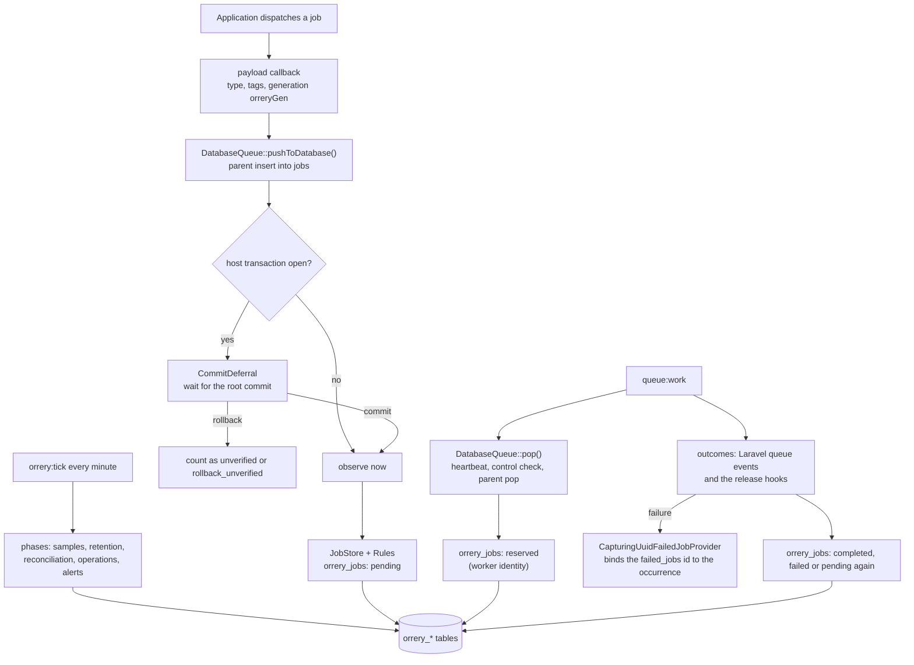

# Architecture overview

Orrery (`justrau/laravel-orrery`, namespace `Justrau\Orrery`) gives Laravel's **database** queue driver a Horizon-style dashboard. This page is the map for a reader who is new to the package. The nested `CLAUDE.md` files and the class docblocks hold the detail; the section "Where to read more" lists them.

## What it is: a watcher only

Orrery never starts, supervises or scales queue workers. You run `queue:work` (or `queue:listen`) as before, under systemd, supervisord, Forge or another process manager. Orrery observes what the queue and the workers do, keeps its own record of each job, and gives:

- a dashboard (a Vue SPA) and a JSON API;
- per-minute throughput and runtime counts, wait times and long-wait alerts;
- tag monitoring, failure groups and job history;
- retry and forget of failed jobs, one by one or in bulk runs;
- stuck-job signals, incidents and notifications;
- pause, continue and terminate signals that the workers obey.

Two rules follow from "watcher only":

- **It never throws into the host.** Every package operation runs inside `Runtime\Watcher::run()` or `attempt()`. When Orrery fails, the queue, the job and the application's transactions behave as if the package were not installed. The failure is counted and reported, and the report carries no job value (`Runtime\SafeError`).
- **The application's tables stay authoritative.** `jobs`, `failed_jobs` and `job_batches` belong to Laravel. Orrery keeps a mirror of them in its own `orrery_*` tables. The package itself changes the application's tables only through operator actions (retry, forget, `orrery:clear`).

## The main parts

| Part | Directory | Job |
| --- | --- | --- |
| The swapped queue | `src/DatabaseQueue.php`, `src/Connectors/` | Calls Laravel's `DatabaseQueue` unchanged, then builds an observation from the parent's return value. |
| Observation | `src/Observation/`, `src/Queue/` | Classifies each payload (type, tags, generation), defers observations until the host transaction commits, captures bulk pushes. |
| Lifecycle | `src/Lifecycle/` | `JobStore` applies each observation to `orrery_jobs` with the pure rules of `Rules`. |
| Storage | `src/Storage/` | Package sessions, transactions, clocks, the SQLite host-file policy. |
| Runtime | `src/Runtime/` | The watcher, the mirror breaker, degradation counts and health events. |
| Operations | `src/Retry/`, `src/Failed/` | The operation ledger and the fence: retry and forget. |
| Monitoring | `src/Monitoring/`, `src/Failures/` | Wait times, per-minute samples, tag monitoring, failure groups, stuck incidents. |
| Control | `src/Control/`, `src/Workers/` | Worker heartbeats, the pause model, terminate. |
| Maintenance | `src/Maintenance/` and each area's `Phases/` | The tick (`orrery:tick`), retention, reconciliation. |
| Schema | `src/Database/` | `PackageSchema`, models, repositories. |
| HTTP | `src/Http/`, `routes/web.php`, `resources/js/` | The JSON API and the SPA. |

`OrreryServiceProvider::MODULES` registers these parts as nine modules, in a fixed order: storage, runtime, observation, lifecycle, operations, maintenance, monitoring, control and HTTP. The provider wraps every listener in a driver filter (only `database` queue connections) and the watcher.

## How a job flows

1. **Push.** A payload callback (`Observation\PayloadClassifier`) stamps the payload with its type, normalised tags, a silenced flag, the push time and a random generation `orreryGen`. The package's `DatabaseQueue` calls Laravel's insert, and observes the insert with the returned job id. When the push happens inside a host transaction, `Observation\CommitDeferral` holds the observation until that transaction commits; a rollback counts it instead of writing it.
2. **Reserve.** In a worker, `pop()` writes the worker heartbeat (throttled), checks the control signals, calls the parent `pop()`, and observes the reservation with the worker's identity.
3. **Complete, fail or release.** `LifecycleModule` listens to Laravel's queue events (`JobProcessing`, `JobExceptionOccurred`, `JobTimedOut`, `JobProcessed`, `JobFailed`, `JobAttempted`, `JobRetryRequested`). A release is observed in `release()` and `deleteAndRelease()`. A completion writes the runtime. A failure starts a new occurrence, and `Failed\CapturingUuidFailedJobProvider` binds the inserted `failed_jobs` id to it, so a later retry or forget acts on exactly that record.
4. **The tick.** `orrery:tick` runs every minute from Laravel's scheduler. It runs the tick phases in priority order, each inside the watcher, with a cooperative deadline: per-minute counts, retention, heartbeat sweep, bulk resolution, reconciliation with `jobs` and `failed_jobs`, signal expiry, queue samples, stuck incidents, markers, the operation runner, the retention of operations, samples, markers and health events, then the stuck notifications and the long-wait alerts.

`JobStore` serves the expected case with one conditional statement (an insert-or-ignore for a push, one update for a reservation or a release). Every other case reads the row, asks `Rules::decide()`, and writes with a guard that re-checks what it read. `docs/architecture/lifecycle-rules.md` lists every rule.

**Uninstrumented connections.** With `orrery.swap_connector` off, or when another package's connector owns the `database` driver, Orrery sees only the outcomes from the events: there are no `pending` or `reserved` rows. `/api/health` and `/api/workload` name those connections.

## The storage model

- **Package sessions.** Every package read and write runs on a `Storage\PackageSession`, never on the application's connection. The package builds each session itself from the connection's writer configuration: not persistent, a 5 s connect timeout, lock and statement timeouts, no transaction manager and no event dispatcher. So package statements never join the host's transactions and never reach Telescope, Pulse or the host's query listeners. There is one session per connection name and process.
- **The mirror.** The `orrery_*` tables live on the mirror: the connection that `orrery.database` names, else the default connection. `orrery_jobs` holds one row per job with its status (`pending`, `reserved`, `completed`, `failed`, `retrying`, `unknown`), cycles, generations, occurrences and outcome counts. Related tables hold tags, history, cycle summaries, samples, heartbeats, signals, health events, operations, fences, incidents and bulk runs.
- **The sibling SQLite file.** When `orrery.database` is empty and the default connection is a SQLite file, the mirror is a separate file next to it, `<name>.orrery.sqlite`. The package installs that file's schema itself on first use. So the package's automatic writes stay out of the application's file, where they would compete with Laravel's queue transactions for the one SQLite write lock.
- **SQLite host files (D17, D18).** A host file is a SQLite file that the application uses (queue, failed jobs, batches, cache). The package never writes a host file automatically: only an operator action does. It reads one automatically only when the file is in WAL mode; otherwise the values are unknown, and `/api/health` lists a warning.
- **Times.** Every stored package time is epoch seconds in a `decimal(16,6)` column. Deadlines use the database server's clock (`Storage\DatabaseClock`), each in its own database.
- **Schema.** `Database\Schema\PackageSchema` defines every table and the schema version. The main migration calls it and is frozen; `src/Database/CLAUDE.md` describes the upgrade path.
- **The breaker.** A lost connection of the mirror opens a breaker for `orrery.observer.breaker_seconds`. While it is open, observations are skipped and counted, and the queue keeps working. `Runtime\Degradation` flushes the counts to `orrery_health_events`.

## Operations: the ledger and the fence

Retry and forget change tables outside the mirror (the queue's `jobs`, the application's `failed_jobs`), so they need a rule that holds across databases, crashes and concurrent operators.

- **The ledger.** `orrery_operations` on the mirror is the single authority of every retry and forget, and the audit log of operator actions. An operation moves `claimed` → `published` → `done`, or `claimed` → `aborting` → `aborted`. Every transition is guarded, so one actor wins. The claimed mirror row holds the `operation_id`.
- **The fence.** `orrery_fences` exists in every database where an operation has an effect: the queue database of a retry and the failed-record database of a delete or a restore. Each effect inserts its fence row, keyed by (`operation_id`, `slot`), in the same transaction as the effect. A stale or concurrent actor loses on the primary key, so each effect happens at most once.
- **Retry.** Refusals first, then the claim in one mirror transaction, then the publication in one transaction on the queue's session: the fence insert, the record delete (mode `in_tx`), and `pushRaw()`. An error before COMMIT aborts; an unclear COMMIT is decided later through the fence.
- **Forget.** The claim, the fenced exact delete of the failed record, then the mirror delete.
- **The runner.** The tick phase `operations` finishes or aborts unfinished operations with backoff. `orrery:resolve` and `POST /api/operations/{id}/resolve` run a pending step as an operator action.
- **Supported failers.** Retry and forget write only with Laravel's `database-uuids` failer, which the package replaces with `CapturingUuidFailedJobProvider` after it verifies the binding. With the null failer, a retry pushes the mirror's copy of the payload and a forget deletes only the mirror row. With any other failer, retry and forget are refused.

`orrery:install --fence` writes the fence migration for each database that needs one; `/api/health` lists the missing ones.

## The HTTP API and the SPA

- **Routes.** `routes/web.php` mounts the page and the JSON API under `orrery.path` (default `orrery`), behind the `orrery` middleware group and `Http\Middleware\Authenticate`.
- **Two abilities.** The `viewOrrery` gate guards every route; the `operateOrrery` gate also guards every write route, chosen by HTTP method. The `local` environment always has access. `orrery:install` publishes a provider stub where the application defines the gates.
- **The API.** Under `/api`: workload, workers, health, counts, control, tags, job lists and detail, stuck jobs, batches, throughput, markers, queue history, job classes, failure groups, bulk runs, and the retry, forget and resolve writes. Times are epoch seconds; windows are half-open; a value that could not be read is null or `unknown`, never zero. Every error has a stable `error` code.
- **The SPA.** Vue 3, built with Vite into `dist/`, which is committed. The package publishes no assets: `Orrery::css()` and `Orrery::js()` inline `dist/` into the page, with the CSP nonce when one is set. The page loads no external font: the Inter font is bundled. The shell polls the shared data every 10 s, and the screens are Overview, Queues, Workers, Jobs, Failed (the failure groups), Tags, Classes and Batches. Write controls show only when the page says the user can operate, and the server still refuses with 403.

## Artisan commands

| Command | Job |
| --- | --- |
| `orrery:install` | Publishes the config, the provider stub and the migrations; `--fence` writes the missing fence migrations, `--indexes` builds the deferred indexes. |
| `orrery:tick` | The tick. The package schedules it every minute unless `orrery.schedule` is false. |
| `orrery:retry`, `orrery:forget` | One retry or forget by uuid; with `--all`, a bulk retry run over a scope, or a forget of every failed record in a scope. |
| `orrery:resolve` | Runs the pending step of one operation, or of every operation that waits for an operator. |
| `orrery:reconcile` | The operator path of reconciliation, also for a SQLite host file that the tick does not read. |
| `orrery:clear`, `orrery:clear-metrics` | Deletes waiting jobs with their mirror rows; clears the per-minute counts. |
| `orrery:pause`, `orrery:continue`, `orrery:terminate` | The control signals, for all queues, one connection or one queue. |
| `orrery:deployed` | Records a deploy marker for the charts. |

## Key decisions

- **Watcher only.** Process managers already run workers well; Orrery adds visibility without owning the workers' lifecycle.
- **Subclass `DatabaseQueue` and swap the `database` connector.** Each hook builds its observation from the parent's return value: the inserted job id, the reserved job, the new job id of a release.
- **The parent's call is never changed.** Each hook calls its parent once, outside the watcher, so the queue behaves the same with and without the package.
- **Commit deferral instead of eager writes.** A push inside a host transaction that rolls back must not appear as a pending job.
- **Package sessions of their own.** Package statements must not join, slow or break the host's transactions, and must not appear in the host's query tooling.
- **The sibling SQLite file.** The package's writes must not compete for the application's SQLite write lock.
- **No automatic write to a SQLite host file (D17), automatic reads only in WAL (D18).** A package reader or writer must never block or lock the application's own file.
- **The tick on Laravel's scheduler.** There is no supervisor loop to drive maintenance, so one scheduled command does it.
- **Per-minute samples counted by the tick.** The hot path writes no metric, so its cost stays fixed (`HotPathBudgetTest`).
- **The operation ledger and the fence.** A retry or forget spans databases; only a fence row in the same transaction as the effect proves it happened once.
- **Unknown is never zero.** A monitoring tool that shows 0 for a value it could not read gives false comfort.
- **The pause scopes are an OR.** A continue of one scope never lifts the pause of another scope, and its result names every cause that still pauses the target.
- **Epoch seconds everywhere.** No stored or sent time depends on a time zone.
- **Inline `dist/`.** The page works without a publish step, and assets cannot drift from the installed version.

## ADR-001: the name

The package was first named `laravel-database-queue-ui`; on 2026-09-23 it became **Orrery**, a clockwork model of the planets that you watch. New code uses only the new names.

| Surface | Old name | New name |
| --- | --- | --- |
| Composer package | `justrau/laravel-database-queue-ui` | `justrau/laravel-orrery` |
| PHP namespace | `JustRau\DatabaseQueueUi\` | `Justrau\Orrery\` |
| Main class | `DatabaseQueueUi` | `Orrery` |
| Service provider | `DatabaseQueueUiServiceProvider` | `OrreryServiceProvider` |
| Gate | `viewDatabaseQueueUi` | `viewOrrery` |
| Config file and key | `config/db-queue-ui.php`, `db-queue-ui.*` | `config/orrery.php`, `orrery.*` |
| Path, middleware group, view namespace, route names, publish tags | `db-queue-ui` | `orrery` |
| Artisan commands | `db-queue-ui:*` | `orrery:*` |
| Tables | `db_queue_ui_*` | `orrery_*` |
| Environment variables | `DB_QUEUE_UI_*`, `DBQUI_*` | `ORRERY_*` |

## Where to read more

- `docs/architecture/lifecycle-rules.md`: every rule of `Lifecycle\Rules`, with its old id and the conventions of every rule.
- `src/CLAUDE.md`: the layout, the registration modules, the binding lifetimes, the commands and the configuration.
- `src/Storage/CLAUDE.md`, `src/Runtime/CLAUDE.md`, `src/Observation/CLAUDE.md`, `src/Lifecycle/CLAUDE.md`, `src/Retry/CLAUDE.md`, `src/Monitoring/CLAUDE.md`, `src/Control/CLAUDE.md`, `src/Maintenance/CLAUDE.md`, `src/Database/CLAUDE.md` and `src/Http/CLAUDE.md`: each area in detail.
- `resources/js/CLAUDE.md`: the SPA.
- `tests/CLAUDE.md`, `bin/CLAUDE.md` and `workbench/CLAUDE.md`: the test harness, the scripts and the Workbench.
