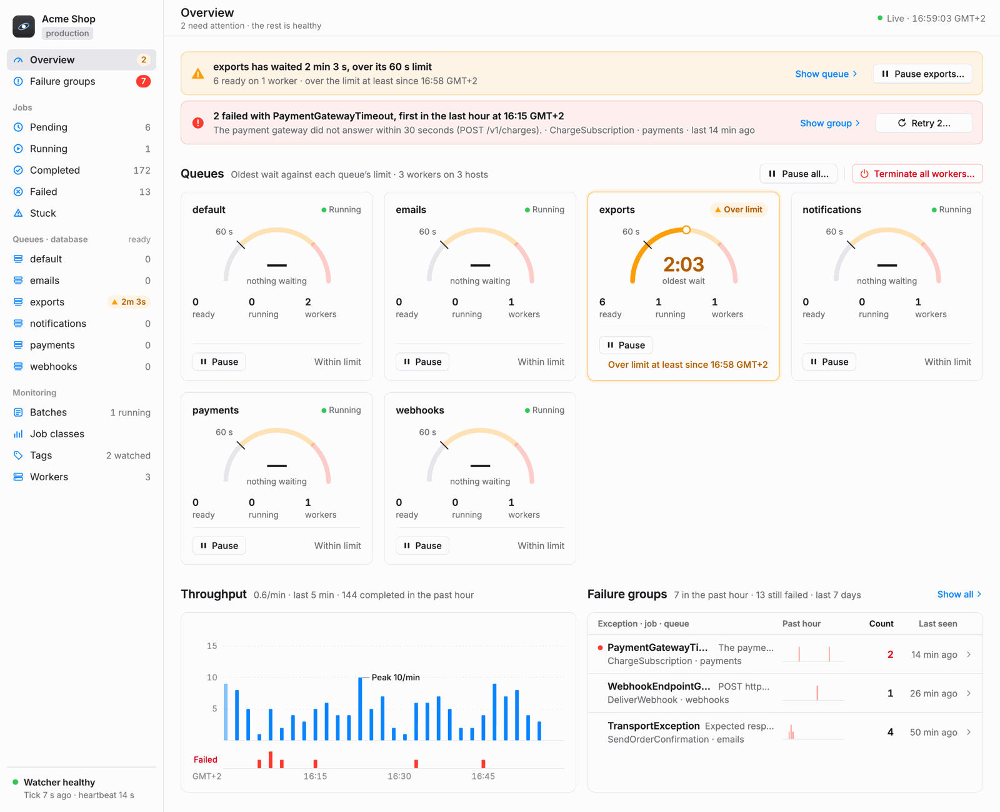
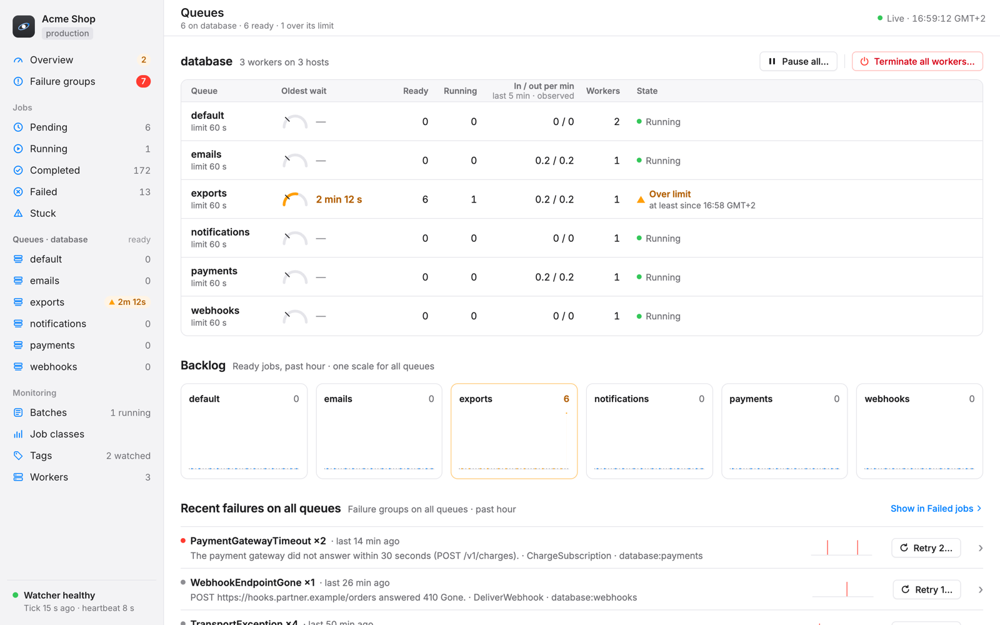
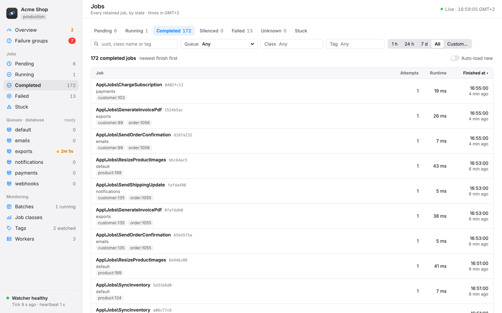
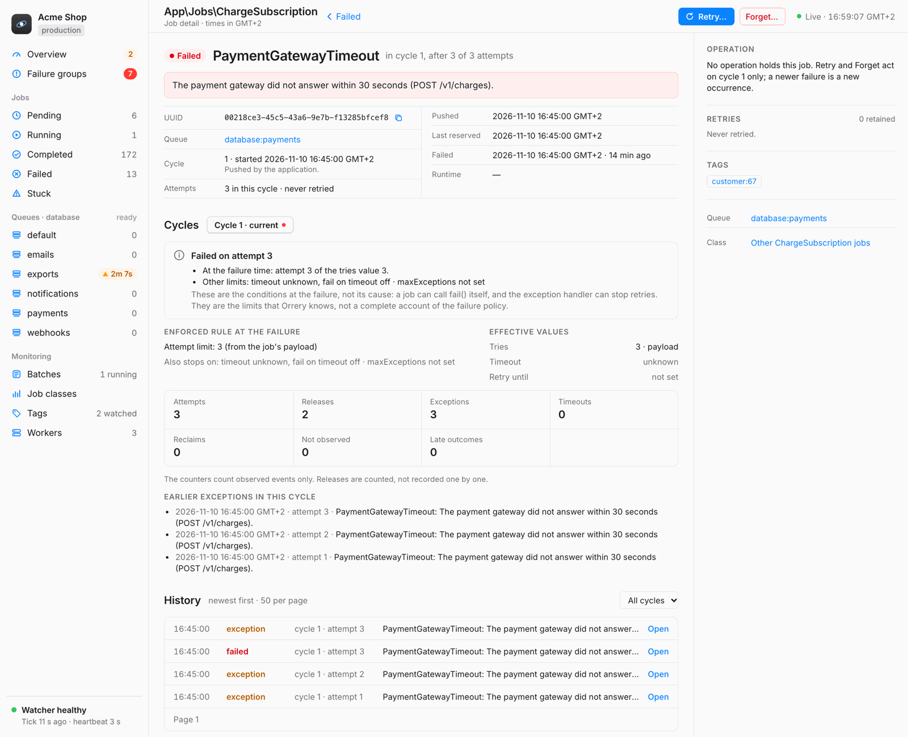
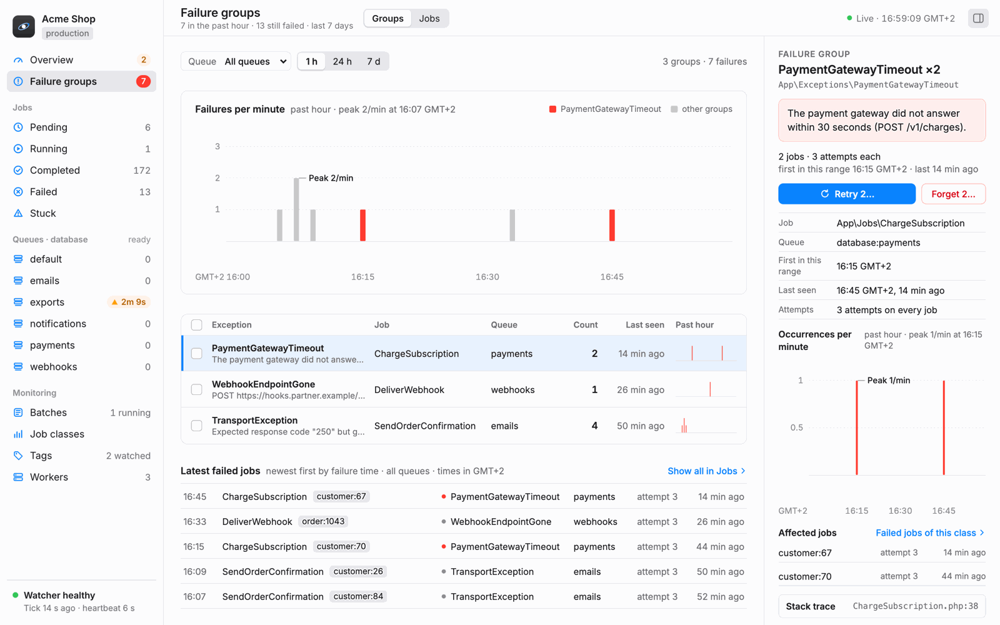
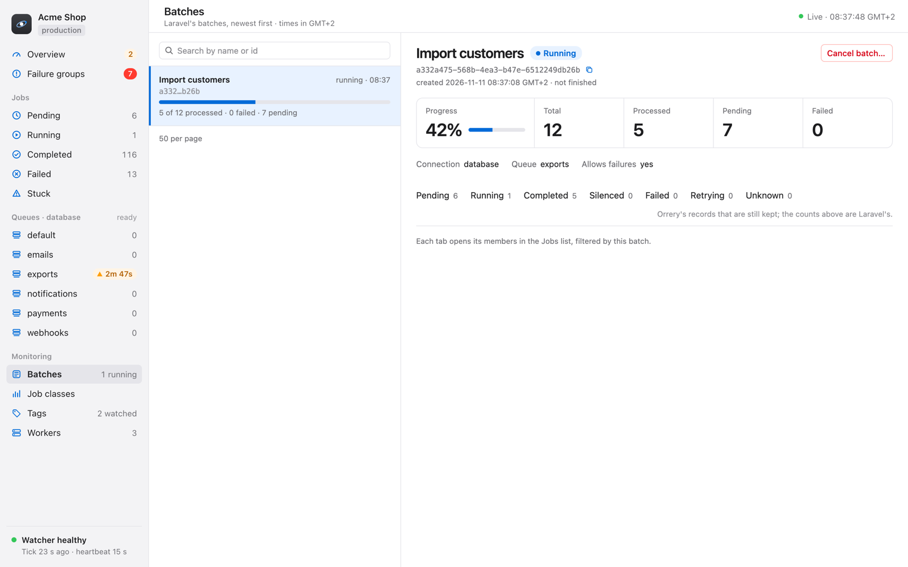
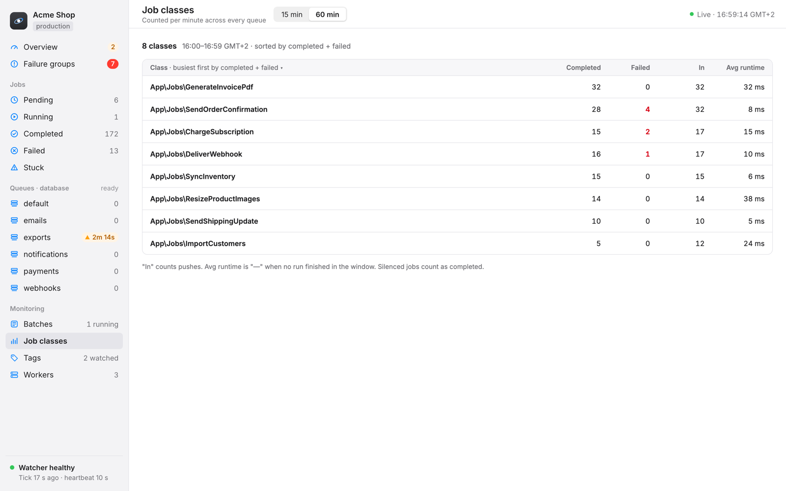
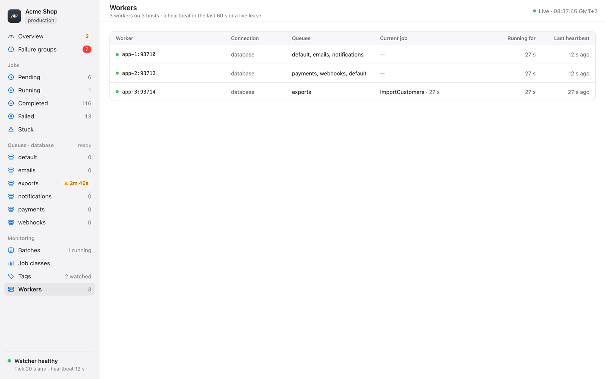

# The dashboard

## Screens

- **Overview:** what needs attention (a queue that waits longer than its limit and is not paused, a failure group that failed in the last 15 minutes), one card per queue with a wait gauge and Pause or Continue, the completed and failed jobs per minute of the last hour with the deploy and restart markers, and the latest failure groups.
- **Queues:** each queue with its wait against its limit, the ready and running jobs, the in and out rates of the last 5 complete minutes, and the workers. A selected queue shows its backlog of the last hour, its workers, its recent failure groups and how long its jobs are kept, with "Clear waiting jobs…".
- **Failure groups:** the failed jobs grouped by exception class, first line of the message and job class, for the last hour, 24 hours or 7 days, with a queue filter. A group shows its message, occurrences, jobs and stack trace. Retry and Forget start a bulk run.
- **Jobs and Job detail:** every job that the package keeps, in tabs (pending, running, completed, silenced, failed, retrying, unknown and stuck), with filters (queue, job class, tag, time range) and a search (a full uuid, a part of the job name, or an exact tag). The detail shows the status, the cycles, the retries, the history, the payload as a tree, the exception and the context, all redacted, with Retry, Forget and Resolve, Delete for a pending job and Run now for a delayed one.
- **Batches:** Laravel's job batches with their progress and member counts. Retry failed members starts a bulk run; "Cancel batch…" cancels an open batch.
- **Job classes:** the completed, failed and pushed jobs and the average runtime per class over 15 or 60 minutes.
- **Tags:** the monitored tags and their jobs.
- **Workers:** the live workers and their current jobs. A worker is live when it wrote a heartbeat in the last 60 seconds (or in the last two `workers.heartbeat_seconds`, when that is longer) or holds a reservation that did not expire. A live worker is **quiet** when its last heartbeat is older than two `workers.heartbeat_seconds` (30 seconds by default) and it holds no reservation that did not expire: it has an amber dot and says how long it has had no heartbeat, for example a worker that was killed with SIGKILL. A worker that runs a long job writes no heartbeat, but its reservation keeps it live. A quiet worker stays in the list until it is no longer live. The Overview and the Queues screen show "Workers quiet" for a queue whose every worker is quiet. The children of `queue:listen` show under their parent.

The old paths `/`, `/dashboard`, `/metrics…`, `/monitoring…`, `/failed/<id>`, `/failed-legacy` and `/jobs/<type>…` redirect to these screens.

- The write buttons show only for users with `operateOrrery`.
- Times show in the browser's time zone, or in `orrery.display_timezone`. Every absolute time has its zone label.
- From 1024 px, drag the handle on the sidebar's right edge to change its width, or focus the handle and use the arrow keys (Shift for bigger steps); a double click resets it. The browser keeps the width.
- Below 1024 px the sidebar is behind a toggle, and below 768 px a list and its detail are two screens. The keyboard reaches every control, and Escape closes a sheet, the inspector or the sidebar.
- The dashboard follows the dark or light appearance of the operating system (the browser's `prefers-color-scheme`). It has no toggle of its own.

## What the numbers mean

- **Unknown is never zero.** A value that the package does not have (a minute without counts, a lost reading, a worker whose current job is not known) shows as "—", a gap or "unknown", never as 0, "idle" or "healthy". A capped count says "at least".
- **Degradation.** The package never lets its own errors reach your queue. An observation that it cannot write is counted in its health events, which `GET /orrery/api/health` returns in `windows`: `dropped` (package operations that did not run or failed, mostly observations not written; one operation can hold several observations, a tick phase none), `unmatched_observations`, `unverified` (deferred observations dropped without a proof of their outcome, or past the count cap or the byte budget of the observations that wait for a commit, see [Known limits](known-limits.md)) and `rollback_unverified` (observations under a transaction that rolled back). When the package database cannot be reached, the package pauses its observations for `orrery.observer.breaker_seconds` (30) and counts them as dropped. Under PHP-FPM each request starts a new application, so the pause reaches the next requests through a small file in `storage/framework` (`observer.shared_breaker`); when the pause ends, about one request at a time tries the database again. When the file cannot be written, the package reports it once per process, so once per request under PHP-FPM. While the pause lasts, the package does not write its health events: a web request or a command that ends during it writes its record to the log instead, so an outage that a web request sees may not show in `windows`. Two lock timeouts of the package's writes within a minute also pause the observations, but only in that process: under PHP-FPM a web request seldom reaches two, so a blocked package table still costs each request its lock timeout. The dashboard footer warns of a recent degradation.
- **"Unreported gaps cannot be ruled out."** The health report always carries this notice. A gap that the package cannot see is never reported.
- **Uninstrumented connections.** The package replaces the `database` queue connector with its own, which records each push, reservation and release (`orrery.swap_connector`, default `true`). When the swap is off, or another package's connector wins the `database` binding, the package mirrors only the outcomes: a pushed or reserved job gets no mirror row, running jobs and arrivals show as unknown, and the children of `queue:listen` do not obey the controls. The ready backlog and the wait still come from the `jobs` table. `/orrery/api/health` lists the connection in `uninstrumented_connections`, and the footer names it. Set the swap to `false` only when your application registers its own `database` connector.
- **Running jobs and leases.** A job is running while its reservation is younger than the `retry_after` of its own queue connection. When several connections share one `jobs` table with different `retry_after` values, the backlog uses the shortest one, as a worker of that connection takes the job again after it. So a job whose reservation passed the shortest lease but not its own counts as running and as waiting.
- **Uncertain operations.** A retry or forget whose outcome is not known yet (a lost COMMIT answer) is `uncertain`. The tick decides it from the fence; it is never retried as new work. An operation whose next step needs an operator waits as "awaiting resolution" (`awaiting_resolution` in `/orrery/api/health`, the footer, a Resolve button on the job page). Run `php artisan orrery:resolve <id>` or `orrery:resolve --all`.
- **The per-minute counts.** The tick counts the completed and failed jobs, the arrivals and the runtimes of each minute into `orrery_samples`. Each run recounts the last 5 minutes, so an outcome that arrives up to 5 minutes late counts. After an outage, each tick catches up at most 65 minutes. A counted quiet minute is 0. A minute that was not counted, whose jobs were deleted before they were counted, or that is older than `samples.retention_hours`, is unknown. `/orrery/api/health` returns `samples` (`counted_through` and the lag), and the footer warns "Counts are behind" after 10 minutes.
- **Late arrivals.** An observation that arrives more than about 5 minutes after its job (for example a push held back by a long transaction of the application) is not counted in its minute, and that minute still reads as counted.
- **Clocks.** The tick counts minutes by the clock of its server. Keep the clocks of the tick servers and the workers within a few seconds of each other (NTP).
